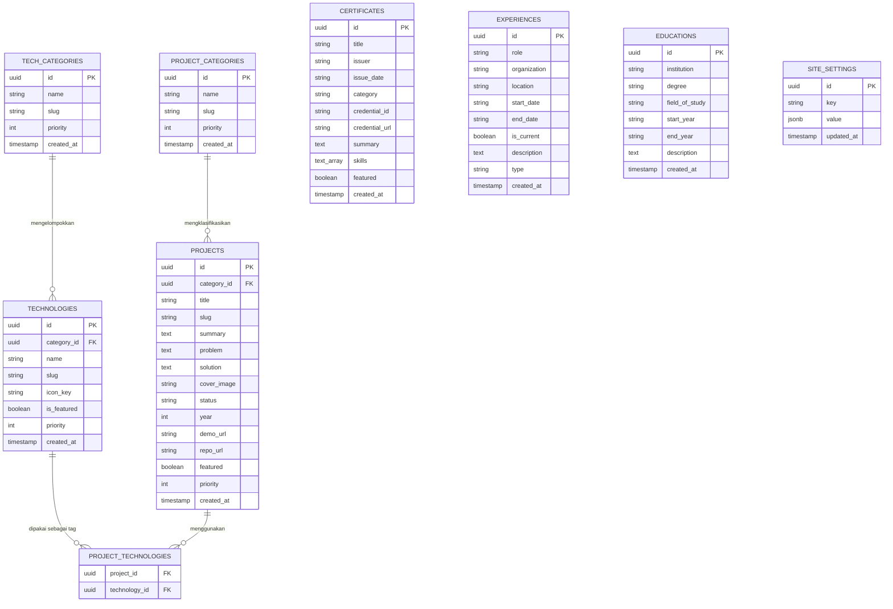

# Roadmap Pembelajaran: Integrasi Next.js + Supabase + Shadcn Admin Dashboard

Dokumen ini adalah panduan komprehensif untuk mentransformasi portofolio personal dari **berkas data statis lokal (`data/*.json`)** menjadi **aplikasi dinamis berbasis cloud database** dengan **Admin Dashboard** pribadi yang diamankan.

---

## 🎯 Target Akhir Sistem

1. **Admin Dashboard Terproteksi (`/admin/*`)**:
   - Dilindungi autentikasi login (Supabase Auth + Next.js Middleware).
   - Dibuat menggunakan komponen UI modern dari **Shadcn UI** (Table, Dialog, Form, Badge, Combobox).
2. **Master Data Tech Stack Dinamis**:
   - Tech stack dikelompokkan berdasarkan kategori (Frontend, Backend, Mobile, DevOps, dll.).
   - Menambah 1 tech stack baru di admin dashboard langsung membuatnya muncul di landing page publik secara otomatis.
3. **Sistem Proyek Terhubung (Many-to-Many Tagging)**:
   - Saat membuat atau mengedit proyek, tech stack dapat dipilih secara dinamis dari database (seperti sistem tags).
   - Gambar sampul proyek diunggah langsung ke **Supabase Storage Bucket**.
4. **Modul Pengelolaan Lengkap**:
   - CRUD Kategori & Item Tech Stack
   - CRUD Proyek & Relasi Tagging
   - CRUD Sertifikasi & Lisensi
   - CRUD Pengalaman Kerja & Riwayat Pendidikan
   - CRUD Tautan Media Sosial & Status Bio
5. **On-Demand Cache Invalidation**:
   - Memanfaatkan Next.js `revalidatePath` agar halaman publik langsung terbarui tanpa perlu *re-deploy*.

---

## 🏗️ Arsitektur & Entity Relationship Diagram (ERD)

Kunci utama sistem dinamis ini terletak pada **Relasi Many-to-Many** antara tabel `projects` dan `technologies` melalui tabel perantara (*pivot table*) `project_technologies`.

---

## 🧠 Kamus Analogi: Laravel vs Supabase / Next.js

Bagi pengembang dengan latar belakang Laravel, konsep Supabase dan Next.js App Router dapat dipetakan secara langsung:

| Konsep di Supabase + Next.js | Padanan di Laravel | Penjelasan Mental Model |
| :--- | :--- | :--- |
| **Row Level Security (RLS)** | `Policy` / `Gate` di Database | Hak akses baris data ditentukan langsung oleh engine PostgreSQL, bukan cuma di aplikasi |
| **Server Action (`'use server'`)** | `Controller Method` + `FormRequest` | Fungsi server yang dipanggil langsung dari form/UI tanpa perlu membuat rute API manual |
| **`@supabase/ssr`** | `Session Guard` / Cookies | Menyimpan session JWT ke dalam HTTP-Only Cookie yang aman dan terbaca di Server Component |
| **Supabase Storage Bucket** | `Storage::disk('s3')` | Tempat penyimpanan file/gambar fisik di cloud dengan URL publik |
| **`revalidatePath('/')`** | `Cache::forget()` / Event Listener | Memerintahkan Next.js membuang cache halaman statis agar data terbaru langsung tampil |
| **Pivot Table (`project_technologies`)** | Relasi `belongsToMany()` | Tabel penghubung antara entity Project dan Technology |
| **Zod Schema** | `$request->validate([...])` | Skema validasi tipe data dan batasan input sebelum diproses |

---

## 🚀 8 Fase Pelaksanaan Belajar

### Fase 1: Setup Proyek Supabase & Skema PostgreSQL
- [ ] Buat akun dan proyek baru di [supabase.com](https://supabase.com).
- [ ] Eksekusi DDL SQL untuk membuat tabel-tabel utama:
  - `project_categories` (kategori proyek: Company Profile, Web App, Mobile App)
  - `projects` (berelasi ke `project_categories` via `category_id`)
  - `tech_categories` & `technologies` (master tech stack)
  - `project_technologies` (pivot many-to-many antara projects dan technologies)
  - `certificates`, `experiences`, `educations`, `site_settings`
- [ ] Aktifkan **Row Level Security (RLS)** di setiap tabel:
  - Role `anon` (pengunjung web): Hanya diizinkan `SELECT`.
  - Role `authenticated` (admin login): Diizinkan `SELECT`, `INSERT`, `UPDATE`, `DELETE`.
- [ ] Buat bucket storage publik bernama `portfolio-assets`.

### Fase 2: Integrasi Supabase SDK di Next.js App Router
- [x] Pasang pustaka dan generator helper resmi Supabase via Shadcn:  
  `bun x --bun shadcn@latest add @supabase/supabase-client-nextjs`
- [ ] Tambahkan konfigurasi kredensial di `.env.local`:
  - `NEXT_PUBLIC_SUPABASE_URL`
  - `NEXT_PUBLIC_SUPABASE_PUBLISHABLE_KEY` *(pada UI lama Supabase disebut `anon key`)*
  - *(Opsional kompatibilitas: `NEXT_PUBLIC_SUPABASE_ANON_KEY` dengan nilai yang sama)*
- [x] Verifikasi berkas helper client yang ter-generate:
  - `lib/client.ts` untuk komponen browser (`'use client'`).
  - `lib/server.ts` untuk Server Components, Server Actions, dan Route Handlers.
  - `lib/middleware.ts` untuk helper sinkronisasi cookie auth di Next.js middleware.

### Fase 3: Autentikasi & Proteksi Rute Admin (Shadcn Block `login-02`)
> 📖 **Panduan Lengkap & Kode**: Lihat [Fase 3: Panduan Autentikasi Admin, Proteksi Proxy & Shadcn Block login-02](file:///C:/Users/ferry/Documents/coding/web-porto-profesional/docs/learn/phase-3-auth-and-protection.md)
- [x] Tambahkan blok Shadcn `login-02` via Bun: `bun x --bun shadcn@latest add login-02`
- [x] Adaptasi halaman login split-screen 2 kolom: `app/admin/login/page.tsx`
- [x] Buat form interaktif Client Component: `components/admin/login-form.tsx` terintegrasi `useActionState`
- [x] Buat Server Action untuk login & logout (`app/admin/actions.ts` via Supabase SSR)
- [x] Buat file `proxy.ts` (konvensi Next.js 16+ pengganti `middleware.ts`) di root project:
  - Proteksi rute `/admin/*` (kecuali `/admin/login`).
  - Refresh cookie session Supabase secara otomatis pada setiap request masuk.

### Fase 4: Shell Layout Dashboard Shadcn UI (Block `sidebar-07` & Route Groups)
> 📖 **Panduan Lengkap & Kode**: Lihat [Fase 4: Shell Layout Dashboard Shadcn UI (sidebar-07) & Route Groups](file:///C:/Users/ferry/Documents/coding/web-porto-profesional/docs/learn/phase-4-admin-layout-and-shell.md)
- [x] Tambahkan blok Shadcn `sidebar-07` via Bun: `bun x --bun shadcn@latest add sidebar-07`
- [x] Pisahkan layout publik dan admin menggunakan Route Groups:
  - `app/(public)/layout.tsx` (Navbar floating publik, preloader, footer)
  - `app/admin/layout.tsx` (Sidebar Shell dashboard admin terisolasi)
- [x] Konfigurasi komponen sidebar:
  - `components/app-sidebar.tsx`: Collapsible icon sidebar shell
  - `components/team-switcher.tsx`: Identitas brand CMS
  - `components/nav-main.tsx`: Menu navigasi berjenjang (Overview, Projects, Tech Stack, Certificates, Experience, Settings)
  - `components/nav-user.tsx`: Profil admin dan tombol sign out via Server Action
- [x] Buat dashboard overview awal di `app/admin/page.tsx`

### Fase 5: Modul Master Data — Tech Stack & Kategori CRUD
> 📖 **Panduan Lengkap & Kode**: Lihat [Fase 5: Modul Master Data — Tech Stack & Kategori CRUD](file:///C:/Users/ferry/Documents/coding/web-porto-profesional/docs/learn/phase-5-tech-stack-crud.md)
- [ ] Install komponen Shadcn UI via Bun: `bun x --bun shadcn@latest add table select switch`
- [ ] Buat tipe data TypeScript di `types/tech-stack.ts`
- [ ] Buat Server Actions mutasi CRUD di `app/admin/tech-stack/actions.ts`
- [ ] Buat form modal dialog kategori (`components/admin/tech-category-dialog.tsx`)
- [ ] Buat form modal dialog teknologi (`components/admin/technology-dialog.tsx`)
- [ ] Buat tabel interaktif dengan search & filter (`components/admin/tech-stack-table.tsx`)
- [ ] Buat halaman Server Component index: `app/admin/tech-stack/page.tsx`

### Fase 6: Modul Proyek & Kategori Proyek (Many-to-Many Tags & Storage)
> 📖 **Panduan Lengkap & Kode**: Lihat [Fase 6: Modul Proyek, Relasi Many-to-Many Tags & Upload Storage](file:///C:/Users/ferry/Documents/coding/web-porto-profesional/docs/learn/phase-6-projects-and-relations-crud.md)
- [ ] Buat tipe data TypeScript di `types/projects.ts`
- [ ] Buat helper upload file ke bucket `portfolio-assets` di `lib/storage.ts`
- [ ] Buat Server Actions CRUD dan sinkronisasi pivot di `app/admin/projects/actions.ts`
- [ ] Buat form interaktif proyek di `components/admin/project-form.tsx` (multi-select tag teknologi, upload cover, dynamic array text)
- [ ] Buat halaman index tabel proyek di `app/admin/projects/page.tsx`
- [ ] Buat halaman create di `app/admin/projects/new/page.tsx`
- [ ] Buat halaman edit di `app/admin/projects/[id]/edit/page.tsx`

### Fase 7: Modul Sertifikasi, Pengalaman, & Pengaturan Web (JSONB)
> 📖 **Panduan Lengkap & Kode**: Lihat [Fase 7: Modul Kredensial, Pengalaman, Pendidikan & Pengaturan Web (JSONB)](file:///C:/Users/ferry/Documents/coding/web-porto-profesional/docs/learn/phase-7-credentials-experiences-settings-crud.md)
- [ ] Buat tipe data TypeScript di `types/credentials.ts` dan `types/settings.ts`
- [ ] Buat Server Actions CRUD sertifikat di `app/admin/certificates/actions.ts`
- [ ] Buat Server Actions linimasa pengalaman di `app/admin/experience/actions.ts`
- [ ] Buat Server Actions upsert JSONB settings di `app/admin/settings/actions.ts`
- [ ] Buat form modal dialog & halaman index sertifikasi (`app/admin/certificates/`)
- [ ] Buat form modal dialog & halaman index linimasa (`app/admin/experience/`)
- [ ] Buat form pengaturan website & tautan sosial media (`app/admin/settings/`)

### Fase 8: Migrasi Halaman Publik (Dari JSON ke Database)
- [ ] Ubah `lib/data.ts` atau buat `lib/queries/*.ts` untuk mengambil data langsung dari Supabase di Server Components:
  - `getAllProjects()` mengambil data dari tabel `projects` join `technologies`.
  - `getAllSkillGroups()` mengambil data dari tabel `tech_categories` join `technologies`.
  - `getAllCertificates()`, `getAllExperiences()`, dll.
- [ ] Lakukan verifikasi performa: data tetap ter-cache di Next.js dan hanya di-revalidate saat ada perubahan dari admin dashboard.

---

## 🛠️ Cara Menggunakan Asisten Belajar Mandiri

Dalam proses pengerjaan roadmap ini, Anda dapat memanfaatkan dua asisten personal di terminal CLI:

1. **Gunakan `/pantau`**:
   - Dipakai saat Anda sedang menulis kode sendiri dan ingin mereview logika:
     > *"Cek kodingan form tech stack gw dong, alurnya udah bener belum?"*
   - Asisten akan membaca `git diff`, memvalidasi logic data flow, memberi analogi Laravel, dan memberikan petunjuk langkah berikutnya tanpa langsung membocorkan jawaban instan.

2. **Gunakan `/jelasin`**:
   - Dipakai saat Anda ingin membedah secara mendalam sebuah konsep teknis, file yang baru saja dibuat, atau arsitektur kode secara komprehensif.
